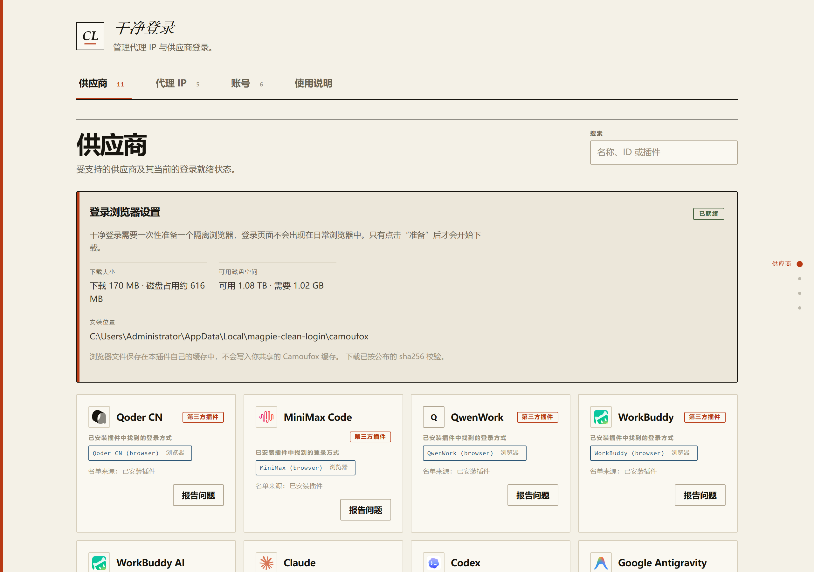
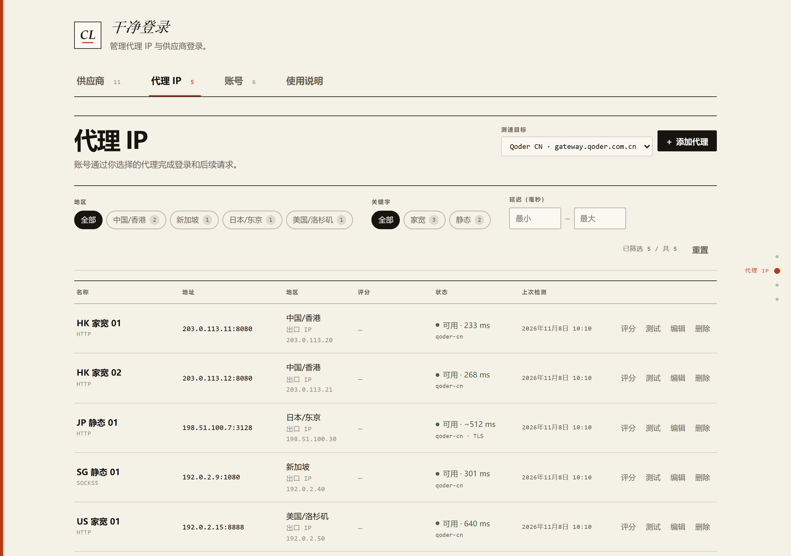
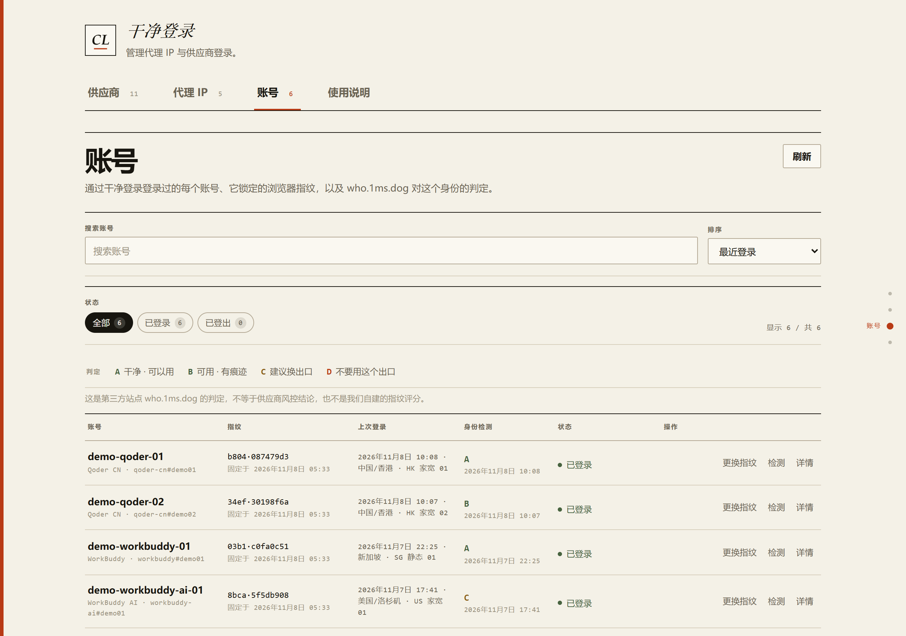
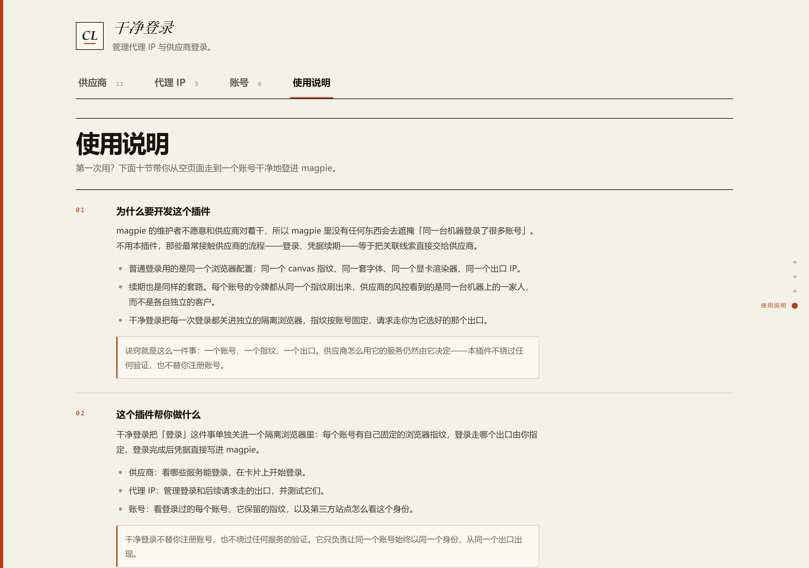
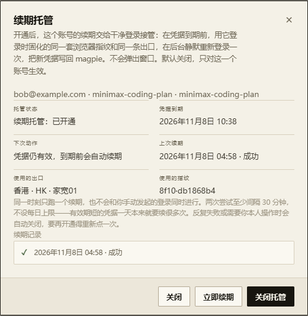

# Magpie Clean Login · 干净登录

[简体中文](README.md) · **English**

[](https://github.com/Gruu6y/magpie-clean-login/tags)
[](https://github.com/Gruu6y/magpie-clean-login/actions/workflows/ci.yml)
[](LICENSE)

**One sentence: when you sign in to several accounts inside magpie, this makes each one look like its own computer on its own network.**

If you only ever use one account, magpie alone is enough. If you have several — two Claude accounts, three WorkBuddy accounts — this is what you need.



> **This is an unofficial plugin.** Built and maintained by [Gruu6y](https://github.com/Gruu6y/magpie-clean-login), **not** published by magpie or `magpie-community`. All the code is public — read it, open issues, send pull requests.

<a id="contents"></a>

## Contents

- [What problem this actually solves](#what)
- [Why use it](#why)
- [Requirements](#requirements)
- [Install](#install)
- [Quick start](#quick-start)
- [The four tabs](#the-four-tabs)
- [Features](#features)
- [Command line and agents](#cli)
- [Troubleshooting](#troubleshooting)
- [Privacy and where data lives](#privacy)
- [Contributing](#contributing)
- [License](#license)

<a id="what"></a>

## What problem this actually solves

Signing in to an AI service inside magpie normally goes: a browser opens → you type your credentials → you are signed in → the credential lands in magpie.

With one account that is fine. **The trouble starts with the second one.**

Providers (Claude, OpenAI, the various Chinese services) record which computer and which network a sign-in came from. They look at more than your IP: they read the browser fingerprint — your GPU model, your installed fonts, your screen resolution, the tiny differences in how your machine renders a canvas. Together those are close to a serial number for your computer.

So:

- You sign in to account A in the same browser you use for account B — the provider sees **two accounts on one computer**.
- Worse is **renewal**. When a credential expires and refreshes, it travels through the same browser identity again, which reminds the provider every so often that these two accounts belong together.
- When one account gets in trouble, the others are easy to take down with it.

**What Clean Login does is simple: it puts every account in its own browser.**

| | Without Clean Login | With Clean Login |
| --- | --- | --- |
| Browser identity | Every account shares one fingerprint | One per account, pinned after sign-in |
| Network exit | Follows your system / magpie global setting | Each account uses the proxy you picked |
| Signing out and back in | Can look like a brand-new computer | Same computer as before, identity kept |
| Renewal | One identity showing up over and over | Each on its own identity and exit |

<a id="why"></a>

## Why use it

**Because magpie does not do this itself.** magpie's maintainers do not want to work against the providers, so nothing in magpie hides the fact that one machine signed in to many accounts. That is not a bug — it is their choice.

Clean Login fills exactly that gap, in three ways:

1. **One account is one machine.** Browser profile, cookies and fingerprint are never shared. Signing out does not throw the identity away; the next sign-in reuses it, so the provider sees an old computer coming back rather than a new one appearing. When a genuinely new machine is what you want, use **Renew fingerprint** on the account row.
2. **The exit you pick is the exit that is used.** Both the login browser **and** the requests the plugin makes itself go through the proxy you chose. Picking "direct" really means direct — it never quietly falls back to magpie's global proxy.
3. **No provider list to maintain.** It reads the provider plugins you already installed and magpie's market catalog. Add a provider to magpie and a card appears here.

> **The boundary, stated plainly:** one account, one fingerprint, one exit. What a provider does with its service is still up to the provider — **this plugin bypasses no verification and does not register accounts for you.**

<a id="requirements"></a>

## Requirements

| | |
| --- | --- |
| Host | [magpie](https://usemagpie.ai) with the Plugins panel |
| OS | **Windows x64** — the login browser downloaded with the plugin is a Windows-only Camoufox build |
| Runtime | Bun **≥ 1.4.2** |
| Disk | ~170 MB download, ~616 MB on disk, ~1.02 GB free during install — once |
| Network | Only for actions you start: proxy tests, the trust-score and identity-check pages, the runtime download, and the provider's own sign-in |

Other platforms are not supported yet; ask on the [issue tracker](https://github.com/Gruu6y/magpie-clean-login/issues) if you need one.

<a id="install"></a>

## Install

1. Open magpie → **Plugins** → **Discover** → **Unofficial**.
2. Find **Clean Login** by **Gruu6y** and click **Install**. If the list has not synced, click **Retry** — magpie caches whatever GitHub told it.
3. Open **Clean Login** from the sidebar. You get the page in the screenshot above.

Every release is tagged in this repository (`v0.1.x`); the [tag list](https://github.com/Gruu6y/magpie-clean-login/tags) is the version history.

<a id="quick-start"></a>

## Quick start

Four steps and you have one cleanly signed-in account. About five minutes, most of it waiting for a browser to download.

### Step 1: prepare the login browser (once)

At the top of the providers page there is a **Login browser setup** block. Click **Prepare browser** and let it finish.

- The download is about **170 MB**, verified against a pinned sha256, fetched once.
- When it is done the block reads **Ready** — that is the state in the first screenshot.
- If it fails you can retry; nothing else is affected.

This installs a **separate browser**, not the one you use every day. Every sign-in happens inside it, so your normal browser stays untouched.

### Step 2: add a proxy exit

Switch to **Proxy IPs** → click **Add Proxy** at the top right → fill in a name, the type (HTTP / HTTPS / SOCKS5), host and port, plus username and password if it needs them.

Then click **Test** on that row. It really connects out through that proxy and tells you **the exit IP, the region, and the latency in milliseconds**.



Three details worth reading in that screenshot:

- The **Test target** picker at the top right can be "Generic (exit check)" or a specific provider. Pick a provider and the number is the latency **to that provider's API host**, not to a generic test site.
- The `JP 静态 01` row reads `~512 ms` with `qoder-cn · TLS` underneath. **The tilde means something:** only the TLS handshake completed and no HTTP response came back, so that number is handshake time, not real request latency. The plugin will not dress it up as a nicer number.
- A failed test **never** falls back to a direct connection silently. It shows you why it failed.

### Step 3: pick a provider and sign in

Back on **Providers**, find the service you want and click **Add account** on its card.

In the dialog:

1. **Pick a proxy** — the dropdown shows each exit's measured latency and puts the ones **this provider has not used yet** first.
2. If the provider needs a value first (a phone number, a site address, a key), the dialog gives you the field. Fill it in, then click **Start sign-in**.
3. For browser sign-in a separate window opens. Sign in there as usual; it closes itself when done and the account appears in magpie. Want out? Just close that window.
4. If the provider sends a one-time code, type it into the same dialog and click **Submit code**.

On success you get: **Signed in. The credential was written to magpie.**

> No **Add account** button on a card? The card says why — usually the provider's plugin is not installed in magpie yet, or that plugin exposes no drivable sign-in method.

### Step 4: check that it really is clean

Switch to **Accounts**. You see the account you just signed in to, its pinned fingerprint, and the exit used last time.

For a second opinion, click **Check** on that row, then **Start check**. The plugin visits the third-party site `who.1ms.dog` through that account's exit and reports an A/B/C/D verdict.



- **A clean · usable** / **B usable · traces** / **C consider another exit** / **D do not use this exit**
- A C or D means that exit is not clean enough. Switch proxies and sign that account in again.
- To make the account **genuinely a different computer** (rather than just a different exit), click **Renew fingerprint** on that row: it signs the same account in again on a freshly drawn fingerprint and deletes the old browser profile. The account and its credential stay. An ordinary "Sign in again" reuses the old fingerprint — the two are not the same thing.

> **This is the third-party site who.1ms.dog's verdict. It is not a provider risk-control conclusion, and it is not a fingerprint score we built ourselves.** It is a second opinion, nothing more.

<a id="the-four-tabs"></a>

## The four tabs

**Providers** — which services you can sign in to. Cards come from your installed plugins and magpie's market catalog, and you start a sign-in right on the card. The search box matches name, id or plugin name.

**Proxy IPs** — manage the exits used for sign-in and later requests, and test them. Filter by region, latency range, or a tag in the name (residential / static). See step 2 above.

**Accounts** — every account you signed in to, the browser fingerprint pinned to it, and what the third-party site thinks of that identity. See step 4 above.

**Guide** — an in-page manual written for a first-time user: ten sections covering why this plugin exists, preparing the browser, adding a proxy, signing an account in, reading the identity verdict, and handing the whole thing to your own agent when you would rather not click. Written separately in all four languages, not machine-translated from English. Plain text: no network, no downloads, nothing executed.



> **About these screenshots:** all four are rendered by this repository's current code in a real Chrome — nothing hand-drawn, nothing composited, no page element substituted. The **account and proxy records are demo data**, using documentation-reserved IPs (`203.0.113.x`, `198.51.100.x`, `192.0.2.x`) and invented account names, because publishing the author's real accounts, exits and credentials in a public repository would be a leak. The provider cards, logos, browser-setup state and interface text are real. The generator is [`scripts/shoot-readme-screenshots.mjs`](scripts/shoot-readme-screenshots.mjs); run `bun scripts/shoot-readme-screenshots.mjs` to reproduce all four.

<a id="features"></a>

## Features

**Signing in**

- Reads your installed provider plugins and offers **Add account** for any that expose a runnable sign-in method (a login page, a form, a one-time code). One plugin exposing several providers gets one card each.
- Providers built into magpie have no plugin to read, so their entry point goes through magpie's own sign-in. When magpie's login page is closed, that sign-in prints the link and Clean Login opens it for you.
- When a provider offers several paths (per-site sign-in, team edition, reusing a desktop session, pasting a key), you choose, and each path is labelled with its type before it starts.
- **Report a problem** on a card opens a GitHub issue with the title and body already written; you only click **Create** ([how it works](docs/reporting.md)).

**Hosted renewal (off by default)**

- On the Accounts tab, press **Host renewal** on a row and then **Enable hosting**. Only that one account is hosted. **Everything is off by default**, installing the plugin enables nothing, and there is no "enable all".
- Once enabled, Clean Login **takes over this account's renewal**: shortly **before** the credential expires it re-runs that account's own sign-in silently in the background -- the **same browser fingerprint** it was pinned with at sign-in (the same `identity.json` and the same persistent profile), through the **same exit** recorded at that login (a direct login stays direct), headless, with no window. The new credential goes back to magpie through exactly the same write-back path a manual sign-in uses.
- **Renewing early is safe**: a hosted renewal is a complete sign-in (authorize, then callback) and **never touches the refresh token**, so there is no single-use token to race magpie for. The only shared resource is the credential slot in `plugin-auth.json`, written through magpie's own locked write-back. Once the credential is fresh, magpie's own at-expiry refresh has nothing to do; if magpie renews first, hosting reads the new expiry and moves its next attempt instead of renewing twice.
- **The lead scales with the credential's lifetime**: an hourly token is renewed 15 minutes early, a daily one about 72 minutes early, and a fortnight- or month-long one **five days** early -- a long-lived sign-in is worth renewing early enough that a transient failure leaves days to retry instead of lapsing. A successful renewal records how long the new credential lives, and the next schedule uses that real lifetime.
- Only one renewal runs at a time, and never alongside a sign-in you started yourself. Attempts are at least 30 minutes apart, with **no daily cap** -- a short-lived credential legitimately needs many renewals a day, and a cap would strangle exactly those accounts. The loop guards are the minimum gap, exponential backoff and switching off after repeated failures.
- Repeated failures, or a sign-in that **needs an answer from you** (a captcha, a device code, a one-time code), **switch hosting off by itself** and write the reason in the dialog — enabling it again is your click. A renewal that comes back as a different account than the one this fingerprint is pinned to is never written back.
- The dialog can **Renew now** (ignores the expiry clock, keeps every guard above), **Stop renewal**, **Disable hosting**, and shows the last 10 renewal records.



**Exits and identity**

- The proxy you pick when adding an account is used for the whole sign-in: the browser window, and the requests the plugin makes to mint links and exchange codes. **A SOCKS exit can only carry the browser window**, not the plugin's own requests — the runtime's proxy support is HTTP/HTTPS only.
- The exit dropdown shows each exit's measured latency and puts the ones this provider has not used first.
- You can fetch a Claude trust score (`ip.net.coffee/claude`, 0–100) through that proxy and keep it on the row.
- With a provider selected as the test target, the number is the round trip to its API host. When only the TLS handshake completes and no HTTP response arrives, that number is explicitly marked as handshake time (`~`) rather than passed off as request latency.
- Signing an account out does not throw away its browser identity; signing in again reuses the same one. When you really do want a different machine, **Renew fingerprint** on the account row signs it in on a new fingerprint, deletes the old profile, and keeps the account and credential.

**Everyday use**

- Every provider card carries the brand mark magpie itself publishes, recoloured for the theme. Drawing them needs no network fetch: the set is copied into `assets/icons/`, where it came from is recorded in `assets/icons/index.json`, and the attribution is in `assets/icons/NOTICES.md`.
- **Four languages**: English, 简体中文, 繁體中文, 日本語, following magpie's language setting.
- Light and dark follow magpie's theme setting, and switching while the page is open is picked up immediately.
- Everything stays on this computer: no account, no telemetry, and no outbound request just to draw a logo.

<a id="cli"></a>

## Command line and agents

**Not sure where to start? Tell your agent and let it drive.**

This page is built for someone holding a mouse, but the plugin also ships a command line and an agent interface. The agent you already talk to can drive the same service directly:

```sh
bun bin/clean-login.mjs agent       # one compact JSON summary of the whole service
bun bin/clean-login.mjs providers   # provider cards only
bun bin/clean-login.mjs proxies     # exits only, no credentials
bun bin/clean-login.mjs accounts    # accounts only
```

The CLI looks for the service on `127.0.0.1:3492` by default (override with `--port` or `--url`), reads the per-process page token from the page the service itself serves, and never prints that token. It has no dependency beyond the runtime's `fetch`, so it starts in milliseconds and never loads the browser modules.

Two things keep a program from having to poll:

- **`GET /api/agent`** returns a compact, self-describing summary: version, service port, command catalogue, and the merged provider cards, proxies, accounts and running-job state. It omits the four-language descriptions the page needs and never includes passwords.
- **`?wait=<ms>`** on the asynchronous routes (`/api/signin`, `/api/native-signin`, `/api/proxy-score`, `/api/environment/job`, `/api/accounts/:provider/:key/check`) blocks inside the service until the job settles or the deadline runs out. One request replaces a polling loop. States that need the caller to act (a one-time code, a value to paste) end the wait immediately.

```sh
bun bin/clean-login.mjs signin start --provider workbuddy --proxy hk-home-1 --wait
bun bin/clean-login.mjs signin code 123456
bun bin/clean-login.mjs proxy score hk-home-1 --wait
```

Run `bun bin/clean-login.mjs help` for the full command list. A remote service (`magpie web`) has no loopback page to read, so pass `--token` explicitly there.

<a id="troubleshooting"></a>

## Troubleshooting

| Symptom | What to do |
| --- | --- |
| A provider card has no **Add account** | The card says why. Market entries need their plugin installed in magpie first; plugin-only providers need a plugin that exposes a browser sign-in method. |
| The login browser reads *not installed* / the download failed | The first run fetches a ~170 MB Windows x64 archive. Check disk space and network, then retry from the providers page. The archive is sha256-verified before it is unpacked. |
| Sign-in fails with `no_url` or `method_input_required` | The plugin wants a value (phone number, site, key) that the dialog did not collect. Fill that field and try again; if it keeps failing use **Report a problem** on the card. |
| A proxy test fails | The test opens a real connection through that exit and never falls back to direct. Check host, port, credentials, and whether that exit is allowed to reach the target. |
| There is a `~` in front of the latency | That is handshake time, not request latency: the target completed the TLS handshake but returned no HTTP response (a WAF blocking the probe is the usual cause). Try another exit. |
| A signed-in account looks like a new machine | Check its pinned fingerprint on the **Accounts** page. Signing in again reuses the same identity; only deleting the account data removes it. |
| You want an account to really be a new machine | Use **Renew fingerprint** on its signed-in row in **Accounts**: it signs the same account in again on a freshly drawn fingerprint and deletes the old browser profile. The account and its credential stay. An ordinary "Sign in again" reuses the old fingerprint. |
| The identity check returns C or D | That exit is not clean. Switch proxies and sign that account in again. |
| Anything else | Open an [issue](https://github.com/Gruu6y/magpie-clean-login/issues) saying what you expected, what happened, and which provider or proxy was involved. A screenshot of the error helps. **Never paste a real token or proxy password into an issue.** |

<a id="privacy"></a>

## Privacy and where data lives

- No telemetry and no account. The only network calls are the ones you start: proxy tests, the trust-score page, the identity-check page, the runtime download, and the provider's own sign-in.
- Proxies, accounts, fingerprints and browser profiles live in `~/.config/magpie/magpie-clean-login/` (override with `MAGPIE_CLEAN_LOGIN_DATA`; the config root itself with `MAGPIE_CONFIG_DIR`). The market catalog is read from `~/.cache/magpie/` (`MAGPIE_CACHE_DIR`). Hosted-renewal switches and recent records live in `renew-hosting.json` in that same directory; it holds switches, times and outcomes, never a credential.
- The login browser unpacks to `%LOCALAPPDATA%/magpie-clean-login/camoufox` on Windows (`MAGPIE_CLEAN_LOGIN_BROWSER_DIR`).
- Stored proxy passwords never reach the page and are never logged. The page token is per-process and exists only in the page the service serves.

<a id="contributing"></a>

## Contributing

Pull requests are welcome. The test suite is the contract: `bun test` runs all of it, and a change without a test is a change nobody will dare trust later. `node scripts/check-version-bump.mjs` decides whether touching `lib/`, `ui/`, `page/` or `index.mjs` requires a version bump; docs-only changes do not. Read [AGENTS.md](AGENTS.md) before you start.

<a id="license"></a>

## License

[MIT](LICENSE) © 2026 Gruu6y. [Tags / version history](https://github.com/Gruu6y/magpie-clean-login/tags) · [Reporting a problem](docs/reporting.md) · [CI](https://github.com/Gruu6y/magpie-clean-login/actions/workflows/ci.yml)
