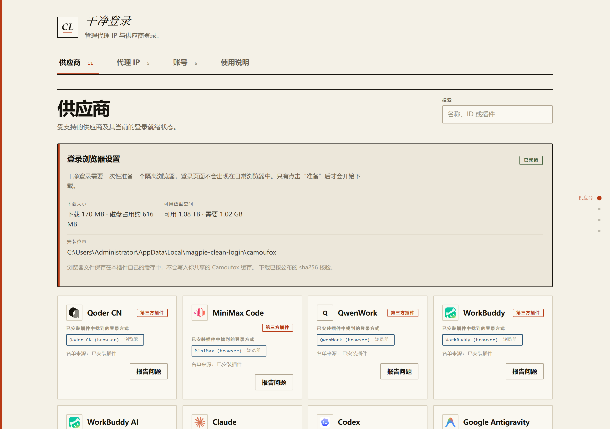
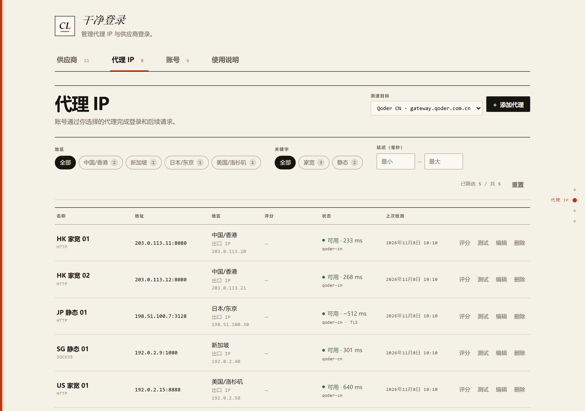
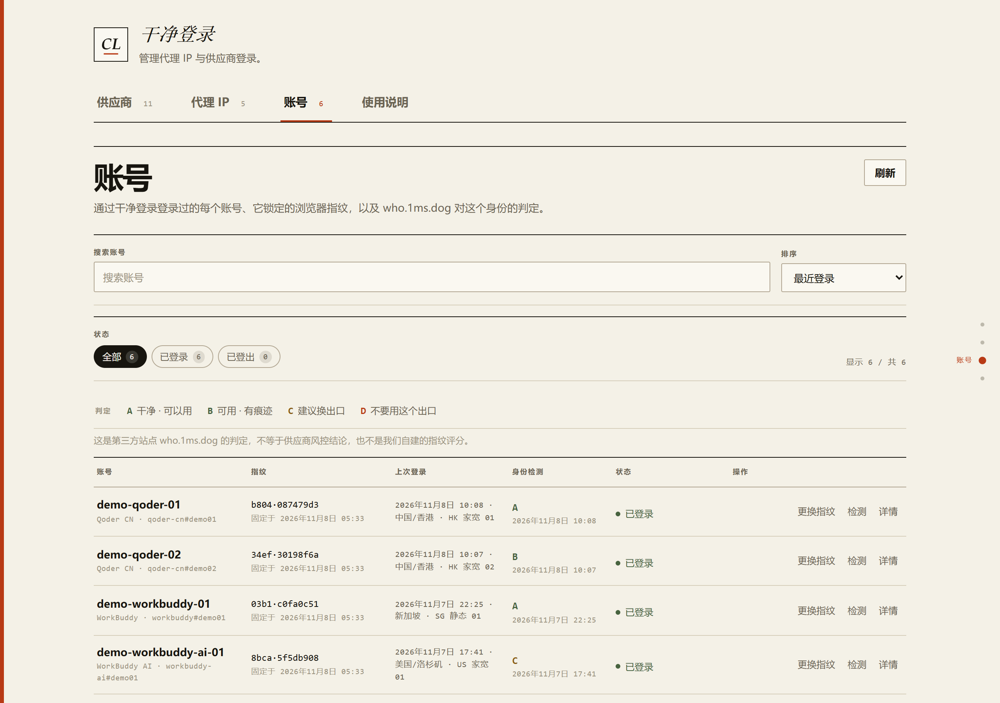

# Magpie Clean Login · 干净登录

**简体中文** · [English](README.en.md)

[](https://github.com/Gruu6y/magpie-clean-login/tags)
[](https://github.com/Gruu6y/magpie-clean-login/actions/workflows/ci.yml)
[](LICENSE)

**干净登录（CL）是 [magpie](https://usemagpie.ai) 的一个非官方插件，用来登录各家供应商：在一个页面里管理代理出口，每个账号都通过自己独立的浏览器身份、自己选定的代理完成登录。规范仓库地址是 [github.com/Gruu6y/magpie-clean-login](https://github.com/Gruu6y/magpie-clean-login)。**



> **非官方插件。** 干净登录就在 [Gruu6y/magpie-clean-login](https://github.com/Gruu6y/magpie-clean-login) 这里开发和维护，**不是** `magpie-community` 发布的，除了你自己没有人审阅过它。读代码、提 issue、发 pull request —— 三件都欢迎。

<a id="contents"></a>

## 目录

- [为什么用它](#why)
- [环境要求](#requirements)
- [安装](#install)
- [快速开始](#quick-start)
- [四个标签页](#tabs)
- [功能](#features)
- [命令行与 agent](#cli)
- [排查问题](#troubleshooting)
- [隐私与数据存放位置](#privacy)
- [参与贡献](#contributing)
- [许可](#license)

<a id="why"></a>

## 为什么用它

- **一个账号就是一台机器。** 浏览器配置、cookie 和指纹从不共用，所以同一家供应商的两个账号不会被看成同一个浏览器。退出登录不会丢掉这个身份，再次登录还是用它。
- **你选的出口就是真正的出口。** 登录浏览器**和**插件自己发出的请求都走你选的那条代理。选**直连**就是真直连 —— 不会悄悄退回 magpie 的全局代理。
- **不用维护一份供应商名单。** 干净登录直接读你已经装好的供应商插件和 magpie 市场目录，只要某个插件提供了登录方式，这里就给出入口。往 magpie 里加一个供应商，它就会出现在这一页。

<a id="requirements"></a>

## 环境要求

| | |
| --- | --- |
| 宿主 | [magpie](https://usemagpie.ai)，带 Plugins 面板 |
| 系统 | **Windows x64** —— 随插件下载的登录浏览器是只有 Windows 版的 Camoufox 构建 |
| 运行时 | Bun **≥ 1.4.2** |
| 磁盘 | 下载约 170 MB，落盘约 616 MB，安装时需要约 1.02 GB 可用空间 —— 只需一次 |
| 网络 | 只用于你自己发起的动作：代理测速、信任分与身份检测页面、运行时下载，以及供应商自己的登录 |

其他平台暂时不支持；平台支持的需求请提到 [issue tracker](https://github.com/Gruu6y/magpie-clean-login/issues)。

<a id="install"></a>

## 安装

1. 打开 magpie → **Plugins** → **Discover** → **Unofficial**（非官方插件）。
2. 找到 **Gruu6y** 发布的 **Clean Login**，点 **Install**（安装）。列表还没同步出来就点 **Retry** —— magpie 缓存的是 GitHub 告诉它的结果。
3. 从侧栏打开 **Clean Login**。

每个版本都在本仓库打了 tag（`v0.1.x`）；[tag 列表](https://github.com/Gruu6y/magpie-clean-login/tags)就是版本历史。

<a id="quick-start"></a>

## 快速开始

第一次登录时，干净登录会下载它自己的浏览器运行时 —— 约 **170 MB**，只下一次，用固定的 sha256 摘要校验。之后全部在你的机器上离线运行。

1. 到 **Proxy IPs（出口 IP）** 添加你想用来登录的出口。
2. 逐条点 **Test**（测试），确认出口 IP 和地区符合预期。想要第二意见，可以再取一个信任分。
3. 到 **Providers（供应商）** 选中供应商 → 选代理 → **Add account**（添加账号）。
4. 如果这家供应商的登录会打开浏览器，就会弹出一个独立浏览器窗口：照常在里面登录，完成后它自己收尾，账号随即出现在 magpie 里。想取消就直接关掉那个窗口。
5. 如果供应商要求先填一个值（比如手机号），在对话框里填好再点 **Start sign-in**（开始登录）。插件发来一次性验证码时，在同一个对话框里输入并点 **Submit code**（提交验证码）。

> 一家供应商需要有 magpie 能驱动的登录方式。没有 **Add account** 的卡片，说明已安装的插件里没有可运行的登录方式 —— 比如一个还没安装的市场条目 —— 卡片上会写清原因。

<a id="tabs"></a>

## 四个标签页

**Guide（使用说明）** —— 页内自带一份面向第一次使用者的说明书，十节讲清为什么要开发这个插件、准备浏览器、加代理、登录账号、看懂身份检测结论，以及不会用时怎么直接交给你的 agent。四种语言各写一份，不是把英文句子机翻过去。纯文字页面，不联网、不下载、不执行任何东西。

**Proxy IPs（出口 IP）** —— 用一条真实连接测试出口，读出出口 IP、地区和延迟，然后按地区、延迟区间以及名字里的标签（家宽 / 静态）筛选。不会退回直连：测试失败就把失败原因摆给你看。测速目标可以选「通用（出口检测）」，也可以选某家供应商，直接测到它的 API 主机。



**Accounts（账号）** —— 每个账号、它固定的指纹、最近一次登录，以及第三方身份检测给出的结论。A/B/C/D 结论来自 `who.1ms.dog`，**不是**供应商的风控结论，也不是我们自己给的指纹分。



> 上面这些截图是从一个本地干净登录实例渲染的，用的是**合成账号**和文档保留段 IP（`203.0.113.x`、`198.51.100.x`、`192.0.2.x`）。本仓库里不出现任何真实凭据。

<a id="features"></a>

## 功能

**登录**

- 读你已安装的供应商插件，只要其中暴露了可运行的登录方式 —— 登录页、表单，或一次性验证码 —— 就给出 **Add account**。一个插件暴露多家供应商时，每家一张卡。
- magpie 自带的供应商没有插件可读，入口改为走 magpie 自己的登录。magpie 的登录页被关掉时，那条登录会把链接打印出来，由干净登录替你打开。
- 一家供应商提供多条路径时（按站点登录、团队版、复用桌面端会话、粘贴密钥），由你来选，而且每条路径在开始前都标好了类型。
- 插件要求填的值在对话框里收集；插件发来的验证码回到同一个对话框。没有窗口可开时就不会开浏览器窗口。
- 卡片上的 **Report a problem**（反馈问题）会打开一个 GitHub issue，标题和正文都已经替你写好 —— 你只需要点 **Create**（[它是怎么工作的](docs/reporting.md)）。

**出口与身份**

- 在添加账号对话框里选定代理，整次登录都用它：浏览器窗口，以及插件用来生成链接、交换验证码的那些请求。**SOCKS** 出口只能带浏览器窗口，带不了插件自己的请求 —— 运行时的代理支持只认 HTTP/HTTPS。
- 添加账号时的出口下拉会显示每条出口的实测延迟，并把**这家供应商还没用过的**排在前面，用过的垫底。
- 测试一条出口就能看到它真实的 IP、地区和延迟。还可以选择通过这条代理去取 Claude 信任分（`ip.net.coffee/claude`，0–100）并留在行上。测速目标选到某家供应商时，测的是到它 API 主机的往返；如果只完成了 TLS 握手而没拿到 HTTP 响应，那个数字会明确标成握手耗时，不冒充请求延迟。
- 代理列表可按地区、延迟区间和名字标签筛选；账号可按状态筛选；供应商可按名称、id 或卡片上的词搜索。命中折叠区里的条目时，会替你把那一区展开。
- 把账号退出登录不会丢掉它的浏览器身份 —— 再次登录复用同一个。

**日常使用**

- 每张供应商卡片都带着 **magpie** 自己发布的那个品牌标，并按主题重新上色。画它们不需要任何网络拉取：这一套已经拷进 `assets/icons/`，取自哪里写在 `assets/icons/index.json`，归属声明写在 `assets/icons/NOTICES.md`。
- **四种语言**：English、简体中文、繁體中文、日本語，跟随 magpie 的语言设置。
- 界面深浅色跟随 magpie 的主题设置，页面开着的时候切换也会立即跟上。
- 一切都留在这台电脑上：没有账号，没有遥测，也不会为了画一个 logo 向外发请求。存下来的代理密码不会显示到页面上，也不会写进任何日志。

<a id="cli"></a>

## 命令行与 agent

这一页是给拿鼠标的人做的。脚本或者 agent 可以不用界面、驱动同一套服务，用随插件带的 CLI：

```sh
bun bin/clean-login.mjs agent       # 整个服务的一份紧凑 JSON 摘要
bun bin/clean-login.mjs providers   # 只看供应商卡片
bun bin/clean-login.mjs proxies     # 只看出口，不含凭据
bun bin/clean-login.mjs accounts    # 只看账号
```

CLI 默认在 `127.0.0.1:3492` 找服务（用 `--port` 或 `--url` 覆盖），从服务自己送出的页面里读取每进程一份的页面 token，并且从不把这个 token 打印出来。除了运行时的 `fetch` 它没有任何依赖，所以毫秒级启动，也不会加载浏览器模块。

有两件事让程序不必轮询：

- **`GET /api/agent`** 返回一份紧凑、自描述的摘要：版本、服务端口、命令目录，以及合并后的供应商卡片、代理、账号和正在跑的任务状态。它不带页面需要的四语言描述、提示和能力原因，也从不带密码。
- 异步状态路由上的 **`?wait=<ms>`**（`/api/signin`、`/api/native-signin`、`/api/proxy-score`、`/api/environment/job`、`/api/accounts/:provider/:key/check`）会在服务内部阻塞，直到任务落定或者时限用完。一个请求就替掉了浏览器那套轮询循环。需要调用方动手的状态 —— 一次性验证码、要粘贴的值 —— 会立刻结束等待，而不是把连接一直挂着。

```sh
bun bin/clean-login.mjs signin start --provider workbuddy --proxy hk-home-1 --wait
bun bin/clean-login.mjs signin code 123456
bun bin/clean-login.mjs proxy score hk-home-1 --wait
```

完整命令列表跑 `bun bin/clean-login.mjs help`。远程服务（`magpie web`）没有回环页面可读，那里要显式传 `--token`；token 就是服务送出的那个页面里嵌的那一份。

<a id="troubleshooting"></a>

## 排查问题

| 现象 | 怎么办 |
| --- | --- |
| 某张供应商卡没有 **Add account** | 卡片上写了原因。市场条目需要先在 magpie 里装上它的插件；只有插件的供应商需要一个暴露了浏览器登录方式的插件。 |
| 登录浏览器显示*未安装* / 下载失败 | 首次运行会取一个约 170 MB 的 Windows x64 压缩包。检查磁盘空间和网络，然后从供应商页重试。压缩包在解包前会做 sha256 校验。 |
| 登录失败，报 `no_url` 或 `method_input_required` | 插件要一个值（手机号、站点、密钥），而对话框没收集到。把那个字段填好再试；要是一直失败，用卡片上的 **Report a problem**。 |
| 代理测试失败 | 测试是通过那条出口建立真实连接，绝不退回直连。检查主机、端口、凭据，以及这条出口是否允许访问目标。 |
| 已登录的账号看起来像一台新机器 | 到 **Accounts** 看它固定的指纹。再次登录会复用同一个身份；删掉账号数据才会把它移除。 |
| 其他情况 | 提一个 [issue](https://github.com/Gruu6y/magpie-clean-login/issues)，写清你预期什么、实际发生了什么、涉及哪家供应商或哪条代理。一张报错截图很有价值。**请永远不要把真实 token 或代理密码贴进 issue。** |

<a id="privacy"></a>

## 隐私与数据存放位置

- 没有遥测，也没有账号。唯一的网络调用就是你自己发起的那些：代理测试、信任分页面、身份检测页面、运行时下载，以及供应商自己的登录。
- 代理、账号、指纹和浏览器配置都在 `~/.config/magpie/magpie-clean-login/`（用 `MAGPIE_CLEAN_LOGIN_DATA` 覆盖；配置根本身用 `MAGPIE_CONFIG_DIR`）。市场目录从 `~/.cache/magpie/` 读取（`MAGPIE_CACHE_DIR`）。
- 登录浏览器在 Windows 上解包到 `%LOCALAPPDATA%/magpie-clean-login/camoufox`（`MAGPIE_CLEAN_LOGIN_BROWSER_DIR`）。
- 存下来的代理密码不会到达页面，也不会写进日志。页面 token 每进程一份，只存在于服务送出的页面里。

<a id="contributing"></a>

## 参与贡献

欢迎 pull request。测试套件就是契约：`bun test` 跑全部，一个没有测试的改动就是以后没人敢信的改动。`node scripts/check-version-bump.mjs` 决定改 `lib/`、`ui/`、`page/` 或 `index.mjs` 是否需要升版本；只改文档不需要。动手前先读 [AGENTS.md](AGENTS.md)。

<a id="license"></a>

## 许可

[MIT](LICENSE) © 2026 Gruu6y. [tag 列表 / 版本历史](https://github.com/Gruu6y/magpie-clean-login/tags) · [反馈问题](docs/reporting.md) · [CI](https://github.com/Gruu6y/magpie-clean-login/actions/workflows/ci.yml)